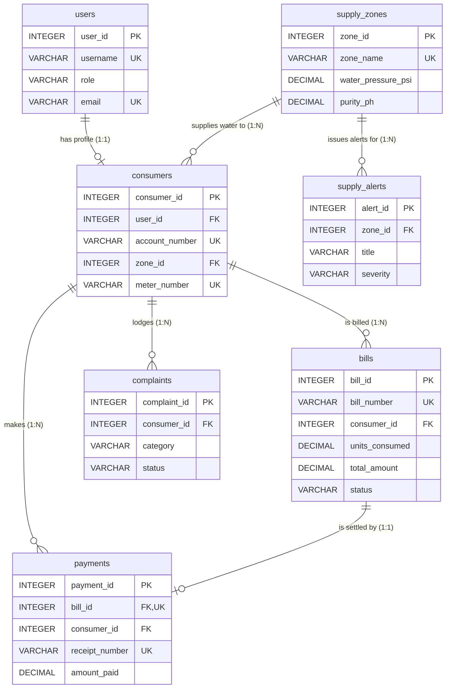

# AquaFlow — Water Supply Monitoring & Consumer Billing System
### Database Management System (DBMS) Academic Capstone Project (IA-3)

AquaFlow is a full-stack Municipal Water Grid Telemetry and Consumer Billing System designed with a **Dual Dashboard Architecture** (Administrator Portal & Consumer Portal) backed by a robust SQLite relational database management system.

> **Comprehensive Academic Report:** See **[DBMS_IA3_Project_Report.md](DBMS_IA3_Project_Report.md)** for complete formal documentation including Problem Statement, Requirements Analysis, Entity-Relationship (ER) Diagram, Relational Schema Mapping, 1NF/2NF/3NF Normalization Analysis, Table Data Dictionaries, SQL DDL/Views/Triggers, Representative Queries, Sample Outputs, and Test Cases.

---

## 📋 Academic Assessment Rubric Alignment (22 Marks)

| Assessment Component | Marks | Key Implementations & Demonstration Points |
| :--- | :---: | :--- |
| **1. Problem Identification & Requirements Analysis** | **5** | Real-world municipal water telemetry, multi-tier progressive slab billing, citizen grievance redressal, dual-role isolation, and live grid monitoring. |
| **2. Schema Design & SQL Implementation** | **5** | 7 normalized relational tables, PK/FK constraints, CHECK constraints, 3 reporting SQL Views, and 2 SQLite business triggers. |
| **3. Application Development & Database Connectivity** | **7** | Python Flask MVC, parameterized queries, atomic multi-table transactions with rollback, CSRF protection, and real-time database health check (`/health`). |
| **4. Validation and Output** | **5** | 21 automated validation test suites covering edge cases, negative readings, IDOR isolation, role/consumer selection, UTC/IST timestamp policy, portal switching, session invalidation, duplicate bill checks, and single-payment enforcement with 100% pass rate. |

---

## 🌟 System Architecture & Features

### 1. Dual-Portal Entry Flow (Demo Access Without Credentials)
* **Root Role Selection (`/` & `/select_role`)**: Clean municipal entry screen with two prominent options:
  * **Administrator Portal**: One-click direct demo entry (`/select_role/admin`) for municipal authority review.
  * **Consumer Portal**: Navigates to `/select_consumer` which queries actual consumer accounts from SQLite.
* **Consumer Selection Screen (`/select_consumer`)**: Displays real registered citizens (e.g., Rahul Sharma, Priya Patel, Apex Hospital, Sun Textiles) showing their Account ID, assigned Ward, Smart Meter serial, and pending dues. Selecting any consumer binds a secure server session restricted strictly to their data.
* **Academic Disclaimer**: Clearly labeled as local academic demonstration access without credentials.

### 2. Administrator Portal (`/admin/dashboard`)
* **Real-time Grid Monitoring**: Telemetry tracking across 4 municipal water distribution wards (reservoir storage percentage, water pressure in PSI, purity pH, and TDS in ppm).
* **Supply Schedule Controls**: Morning and evening slot scheduling with grid status updates (`ACTIVE`, `SCHEDULED`, `MAINTENANCE`, `OUTAGE`).
* **Citizen Outage Broadcasting**: Publish city-wide or ward-specific advisory announcements.
* **Smart Bill Generator Engine**: Select consumer, enter current meter readings, and auto-compute progressive slab tariffs. Updates consumer's dashboard and last meter reading automatically via database triggers.
* **Grievance Redressal Desk**: Inspect and resolve consumer complaints with official administrative response notes and resolution timestamps.

### 3. Consumer Portal (`/consumer/dashboard`)
* **Personalized Connection Profile**: Consumer Account Number (`WTR-xxxx`), Smart Meter Serial (`MTR-xxxx`), Connection Type (`Residential`, `Commercial`, `Industrial`), and assigned Supply Ward.
* **Live Ward Telemetry**: Real-time water supply status and morning/evening release slots for their specific ward.
* **Instant Digital Utility Billing**: Notification of active bills, unit consumption breakdown, and due dates.
* **Payment Processing**: Integrated simulation for UPI, Net Banking, and Cards with receipt generation (`RCPT-xxxx`) and database status update to `PAID`.
* **Printable Tax Invoices**: Formal municipal tax invoices (`/bill/<id>/invoice`) with strict IDOR data isolation.
* **Grievance Submission**: File tickets for low pressure, contaminated water, leaks, or meter faults.

---

## 🗄️ Relational Schema & DBMS Architecture

AquaFlow operates on standard SQL relational principles with foreign key enforcement (`PRAGMA foreign_keys = ON;`). Full detailed schema documentation, data dictionary, and SQL queries are in **[DBMS_IA3_Project_Report.md](DBMS_IA3_Project_Report.md)**.

### 1. Entity-Relationship (ER) Diagram



### 2. Relational Schema Mapping
* **`USERS`** (<u>`user_id`</u>, `username`, `password`, `role`, `full_name`, `email`, `phone`, `created_at`)
* **`SUPPLY_ZONES`** (<u>`zone_id`</u>, `zone_name`, `ward_area`, `reservoir_name`, `reservoir_level_pct`, `water_pressure_psi`, `purity_ph`, `tds_ppm`, `supply_status`, `morning_slot`, `evening_slot`, `updated_at`)
* **`CONSUMERS`** (<u>`consumer_id`</u>, `user_id` [FK], `account_number`, `zone_id` [FK], `connection_type`, `meter_number`, `installation_date`, `address`, `last_meter_reading`, `status`)
* **`BILLS`** (<u>`bill_id`</u>, `bill_number`, `consumer_id` [FK], `billing_month`, `billing_date`, `due_date`, `prev_reading`, `curr_reading`, `units_consumed`, `base_charge`, `consumption_charge`, `tax_surcharge`, `total_amount`, `status`, `notes`, `created_at`)
* **`PAYMENTS`** (<u>`payment_id`</u>, `bill_id` [FK, UK], `consumer_id` [FK], `receipt_number`, `transaction_ref`, `amount_paid`, `payment_method`, `payment_date`)
* **`SUPPLY_ALERTS`** (<u>`alert_id`</u>, `zone_id` [FK], `title`, `message`, `severity`, `is_active`, `posted_at`)
* **`COMPLAINTS`** (<u>`complaint_id`</u>, `consumer_id` [FK], `category`, `description`, `status`, `admin_response`, `created_at`, `resolved_at`)

### 3. Normalization Compliance (1NF, 2NF, 3NF)
* **1NF**: All attributes are atomic scalars. Non-repeating groups. Single-column primary key defined on every table.
* **2NF**: In 1NF and no partial functional dependencies exist on primary keys (all tables use atomic single-column surrogate keys).
* **3NF**: In 2NF and zero transitive functional dependencies exist. Zone details decoupled from consumers; consumer profiles decoupled from billing records.

### 4. Relational Tables (7 Tables)
1. **`users`**: Authentication credentials, hashed passwords (PBKDF2-SHA256 via Werkzeug), roles (`admin`, `consumer`), and contact records.
2. **`supply_zones`**: Distribution wards, reservoir capacities, pipeline pressure, water quality metrics (pH, TDS), and supply windows.
3. **`consumers`**: Consumer account IDs, meter serials, connection types, addresses, last recorded readings, and foreign keys referencing `users` and `supply_zones`.
4. **`bills`**: Billing cycles, previous and current meter readings, units consumed (kL), progressive tariff charges, tax levies, total dues, and status (`UNPAID`, `PAID`, `OVERDUE`).
5. **`payments`**: Payment transaction auditing, unique receipts (`RCPT-xxxx`), transaction references (`TXN-xxxx`), payment methods, and timestamps.
6. **`supply_alerts`**: Ward-specific or municipal-wide emergency outage alerts and chlorination notices.
7. **`complaints`**: Citizen grievances, categorized issue types, resolution notes, and resolution timestamps.

### 5. Database Views (3 Virtual Tables)
* **`vw_bills_detailed`**: Multi-table INNER JOIN connecting `bills`, `consumers`, `users`, and `supply_zones` for complete billing transparency.
* **`vw_consumer_balances`**: Aggregated financial summary utilizing `COUNT`, `SUM`, `CASE WHEN`, and `COALESCE` to track paid vs. pending balances.
* **`vw_zone_monitoring`**: Real-time zone telemetry aggregated with connected consumer counts using `LEFT JOIN` and `GROUP BY`.

### 6. Database Triggers (2 Triggers)
* **`trg_update_consumer_meter_reading`**: `AFTER INSERT ON bills` — Automatically synchronizes `consumers.last_meter_reading = NEW.curr_reading`.
* **`trg_mark_bill_paid`**: `AFTER INSERT ON payments` — Automatically updates `bills.status = 'PAID'` when payments meet or exceed the total bill amount (`COALESCE(SUM(amount_paid), 0) >= total_amount`).

---

## 🔐 Security & Reliability Enhancements

1. **Atomic Multi-Table Transactions**: User registration and consumer profile creation execute inside a single atomic database transaction (`with conn:`). Any constraint violation or error rolls back both records, completely preventing orphaned users.
2. **Centralized Timezone & Timestamp Policy**: All event timestamps (`payments.payment_date`, `bills.created_at`, `supply_alerts.posted_at`, `complaints.created_at`, `complaints.resolved_at`) are generated and stored in Coordinated Universal Time (UTC) formatted as `YYYY-MM-DD HH:MM:SS`. For human presentation, Jinja2 template filters and helper functions (`utc_to_ist_str`, `format_calendar_date`) convert event timestamps to Indian Standard Time (`Asia/Kolkata`, UTC+05:30) with accurate rollover across midnight boundaries. Calendar dates (`billing_date`, `due_date`) are stored as `YYYY-MM-DD` and formatted without timezone drift.
3. **Structured Operational Logging & Correlation IDs**: Standard Python `logging` with a custom `RequestIdFormatter` outputs timestamped server logs with unique hexadecimal correlation request IDs (`[Req:xxxx]`) for every request, logging logins, role transitions, consumer bindings, bill generations, and payments with zero unhandled exceptions.
4. **Single-Payment Enforcement & Deterministic Joins**: Enforces exactly one complete payment per bill. Duplicate payments on settled bills are rejected (`ValueError`). All billing queries use deterministic grouping subqueries (`LEFT JOIN (SELECT bill_id, MAX(payment_id) ... GROUP BY bill_id)`) to guarantee zero row multiplication across consumer and administrator billing ledgers.
5. **CSRF Protection**: All state-changing forms (`POST`) require a cryptographically generated session token (`csrf_token`).
6. **IDOR & Data Isolation**: Consumers are strictly restricted to their own bills, payment receipts, and tax invoices.
7. **Robust Validation**: Meter readings must be non-negative and non-decreasing (`curr >= prev`). Payments must match the outstanding balance. Due dates cannot precede billing dates.
8. **Automatic Overdue Status Synchronization**: Unpaid bills past their due date automatically transition to `OVERDUE`.

---

## 🚀 Installation & Execution Guide

### Prerequisites
* **Python 3.10+** (Tested on Python 3.12.10)
* **PowerShell** (Windows) or Terminal (macOS/Linux)

### 1. Environment Activation
From the project directory (`C:\Users\hp\Documents\aqua`), activate the virtual environment:
```powershell
.\.venv\Scripts\Activate.ps1
```

### 2. Dependency Installation
If not already installed, install Flask:
```powershell
pip install flask werkzeug
```

### 3. Launching the Application
Run the Flask server:
```powershell
python app.py
```
The application starts at:
```
http://127.0.0.1:5000
```

### 4. Database Health Verification
Visit the built-in JSON health endpoint to confirm database connectivity, schema integrity, and table counts:
```powershell
Invoke-RestMethod -Uri "http://127.0.0.1:5000/health"
```

---

## 🧪 Automated Testing & Verification Suite

An isolated test suite runs all 16 verification categories against a temporary database without affecting production data:

```powershell
# Run the complete test suite
python test_aquaflow.py

# Generate a detailed test report table
python generate_test_report.py
```

### Verification Results Summary (21/21 Passed — 100%):
| # | Test Category | Status | Details |
| :-: | :--- | :-: | :--- |
| 1 | Application Startup & Database Connectivity | **PASS** | HTTP 200, SQLite connected, FKs enabled, integrity OK |
| 2 | Required Table and Schema Verification | **PASS** | 7 tables, 3 views, 2 triggers verified in sqlite_master |
| 3 | Valid and Invalid Login Attempts | **PASS** | Valid credentials redirect; wrong passwords rejected |
| 4 | Administrator and Consumer Authorization (RBAC) | **PASS** | Role access controls strictly enforced |
| 5 | Registration Success & Duplicate Prevention | **PASS** | Atomic registration; duplicate username/email rejected |
| 6 | Valid Bill Generation & Slab Calculation | **PASS** | Progressive tariff engine calculated; readings updated |
| 7 | Invalid, Negative & Decreasing Readings | **PASS** | Rejects negative readings, decreasing readings, and non-numerics |
| 8 | Payment Validation & Anti-Duplicate | **PASS** | Rejects partial amounts, wrong consumers, and double payments |
| 9 | Bill Status and Overdue Handling | **PASS** | Automatic transition of past-due bills to OVERDUE |
| 10 | Consumer Data Isolation (IDOR) | **PASS** | Consumers blocked from viewing others' invoices |
| 11 | Complaint Creation & Status Validation | **PASS** | Grievance workflow with category validation and timestamps |
| 12 | Supply-Zone Telemetry Operations | **PASS** | Valid telemetry saved; out-of-range sensor values rejected |
| 13 | Database Integrity & Foreign Keys | **PASS** | Foreign keys enforce referential integrity |
| 14 | Transaction Rollback on Failure | **PASS** | No orphaned users left on profile creation failure |
| 15 | Invalid Form Submissions & Error Responses | **PASS** | Malformed requests return clear HTTP 400 errors |
| 16 | Credential-Free Role & Consumer Demo Selection | **PASS** | Root role selection, admin direct entry, and dynamic SQLite consumer binding |
| 17 | UTC Storage Policy & Asia/Kolkata Display | **PASS** | Stored in UTC; converted to IST across day boundaries; dates preserved |
| 18 | Duplicate Bill Prevention & Date Precedence | **PASS** | Due date before billing date rejected; duplicate cycle bills rejected |
| 19 | Single-Payment Enforcement & Join Determinism | **PASS** | Database UNIQUE constraint on payments.bill_id rejects duplicate; 1-to-1 join confirmed |
| 20 | Portal Switching & Session Invalidation | **PASS** | Switching portals clears privileges; public header enforced; flash notices preserved |
| 21 | Authoritative Payment Timestamp & View Consistency | **PASS** | Exact match across DB UTC record, payment history, receipts, and invoices |

---

## 👥 Demo Navigation Access

When navigating to `http://127.0.0.1:5000`:

1. **Administrator Portal**:
   - Click **Enter as Administrator** to open the municipal admin dashboard.
   - Provides full ward controls, live telemetry editing, slab billing, and consumer grievances.

2. **Consumer Portal**:
   - Click **Select Consumer Account** to see the list of actual consumers retrieved from SQLite:
     - **Rahul Sharma** (`WTR-1001`) — Residential consumer in North Zone - Green Valley
     - **Priya Patel** (`WTR-1002`) — Residential consumer in South Zone - Hilltop
     - **Apex Hospital** (`WTR-5001`) — Commercial consumer in East Commercial District
     - **Sun Textiles** (`WTR-5002`) — Industrial consumer in West Industrial Park
     - **Kavita Rao** (`WTR-105`) — Residential consumer
   - Clicking **Access Consumer Portal** enters that consumer's dashboard with strictly isolated records.

3. **New Connection Registration**:
   - Click **Register New Consumer Connection** to register an atomic consumer profile with zone selection and automatic meter allocation.

---

## 📁 File Structure

```
aqua/
├── app.py                      # Core Flask web application & HTTP routes
├── database.py                 # SQLite database access layer & tariff engine
├── schema.sql                  # Relational schema (DDL, views, triggers)
├── seed_data.py                # Initial database seeder script
├── test_aquaflow.py            # 21-point automated test suite (isolated DB)
├── generate_test_report.py     # Test report generator
├── DBMS_IA3_Project_Report.md  # Comprehensive academic project report
├── README.md                   # Installation & operational documentation
├── requirements.txt            # Python frozen package requirements
├── water_supply_dbms.db        # Production/demo SQLite database
├── screenshots/                # Comprehensive Playwright E2E visual captures
├── static/                     # CSS, assets, and JavaScript files
└── templates/                  # Jinja2 presentation templates
    ├── base.html               # Main application layout & navbar
    ├── role_selection.html     # Credential-free role selection portal
    ├── select_consumer.html    # Dynamic SQLite consumer picker screen
    ├── login.html              # Demo access / role selection wrapper
    ├── register.html           # New consumer registration
    ├── bill_invoice.html       # Printable municipal tax invoice
    ├── admin/                  # Administrator dashboard, billing & supply
    └── consumer/               # Consumer dashboard, bills & grievances
```
