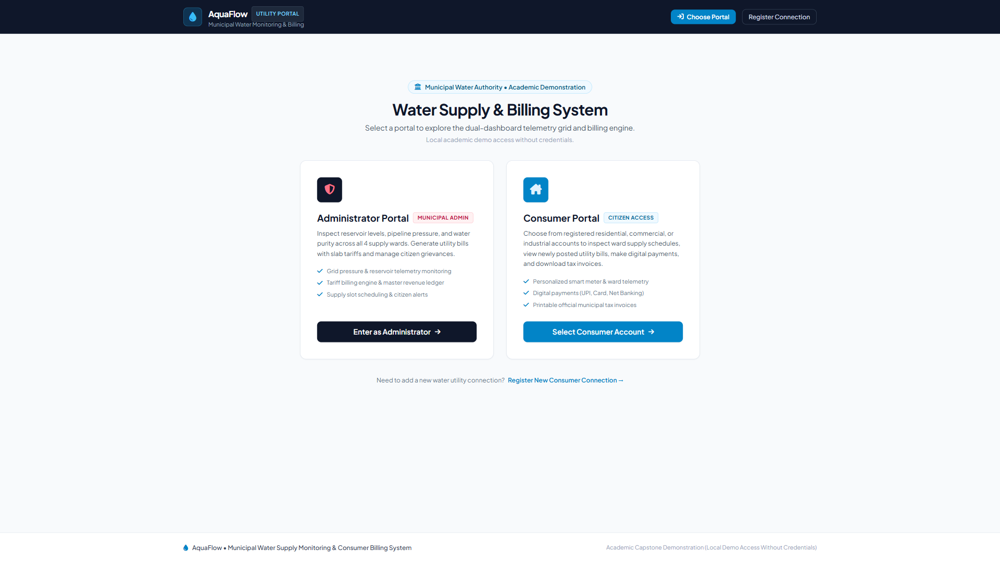
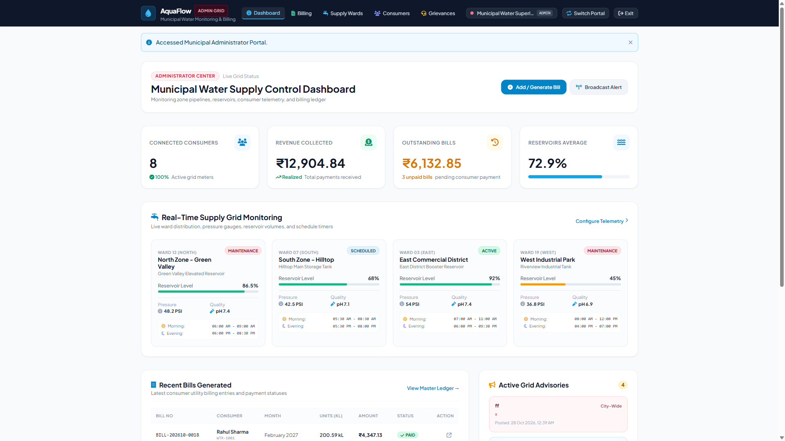
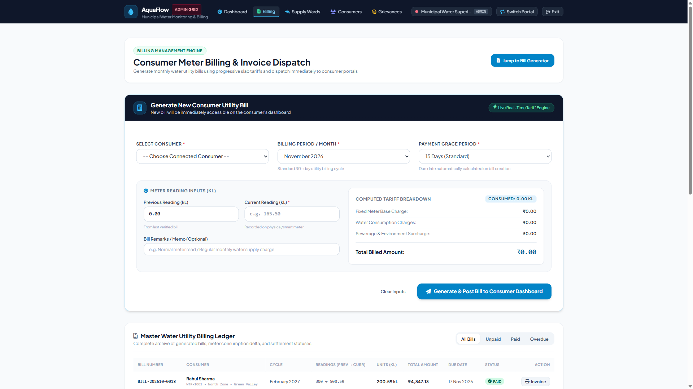
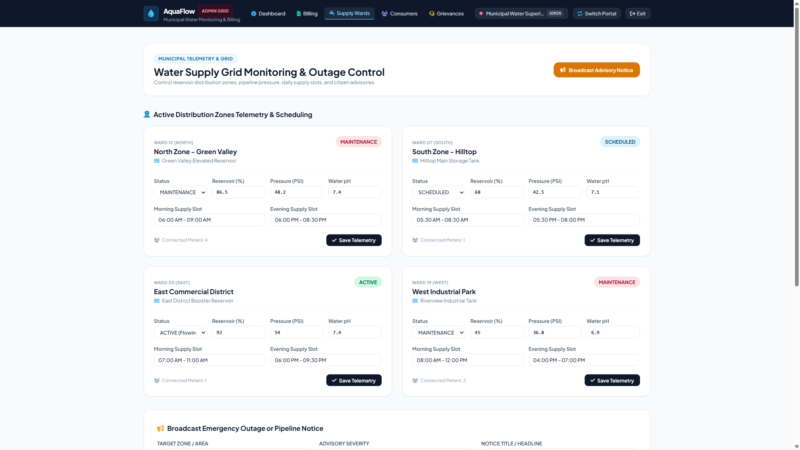
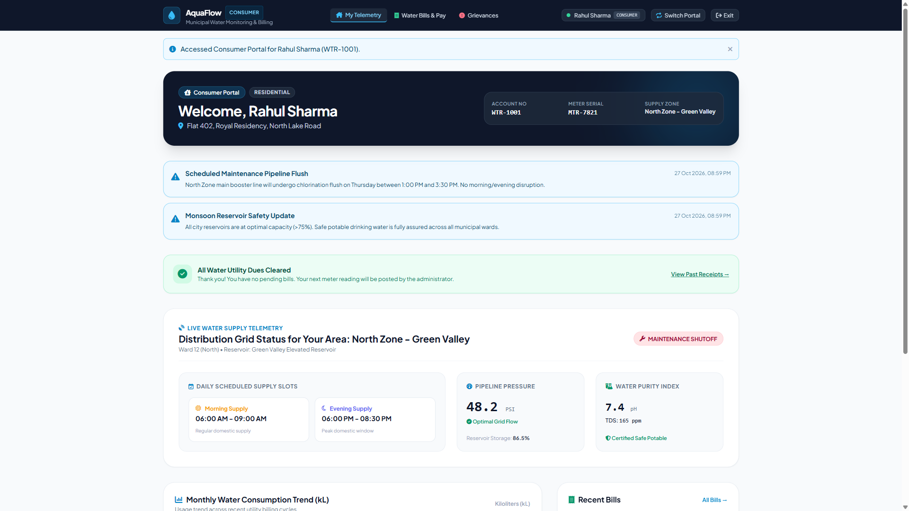
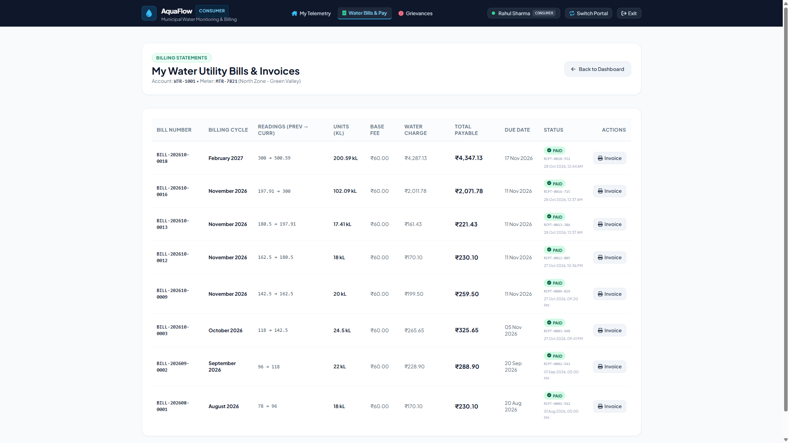
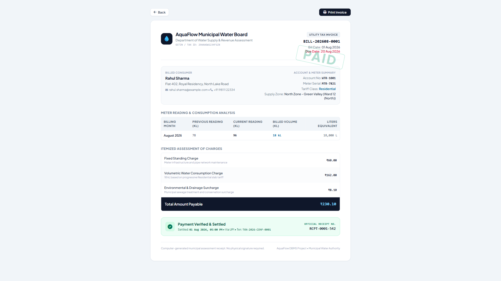
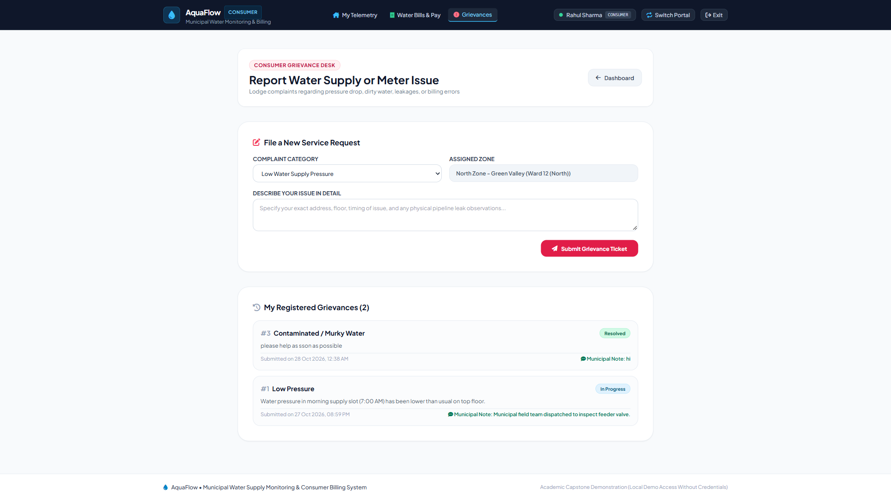

# AquaFlow — Water Supply Monitoring & Consumer Billing

A Flask + SQLite DBMS project for managing water-supply zones, consumer connections, meter readings, bills, simulated payments, alerts, and complaints.

## Features
- Admin and consumer portals
- Consumer registration and account/zone management
- Meter-based bill generation with connection-specific tariff slabs
- Payment simulation with receipt and transaction references
- Supply monitoring, zone alerts, and complaint tracking
- SQLite constraints, foreign keys, 3 views, 2 triggers, and payment-per-bill uniqueness
- Responsive HTML/Jinja templates and automated tests

## Tech Stack
Python · Flask · SQLite · HTML/Jinja2 · CSS · JavaScript

## Run locally
```powershell
python -m venv .venv
.\.venv\Scripts\Activate.ps1
pip install -r requirements.txt
python seed_data.py
python app.py
```
Open http://127.0.0.1:5000/.

> `seed_data.py` is intended to populate demonstration data. Back up any existing `water_supply_dbms.db` before running setup or seeding commands.

## Database design
Seven core tables: `users`, `supply_zones`, `consumers`, `bills`, `payments`, `supply_alerts`, and `complaints`.

Views: `vw_bills_detailed`, `vw_consumer_balances`, `vw_zone_monitoring`.

Triggers: `trg_update_consumer_meter_reading`, `trg_mark_bill_paid`.

## Screenshots

### Landing page


### Administrator dashboard


### Billing management


### Supply monitoring


### Consumer dashboard


### Consumer bills and payment


### Bill invoice


### Complaint management


## Tests
Run the automated suite:
```powershell
python test_aquaflow.py
```

## Notes
- Payments are simulated; no live payment gateway is connected.
- Zone readings are stored application data; no live sensor integration is included in this codebase.
- See [`DBMS_IA3_Project_Report.md`](DBMS_IA3_Project_Report.md) for the detailed academic report.
